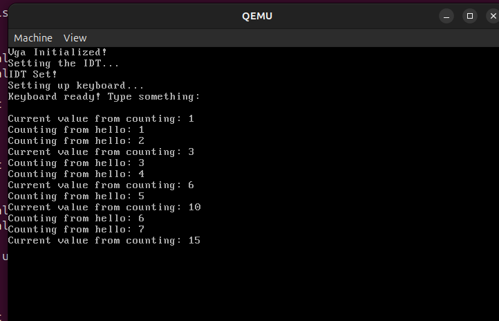

# NTT Educational OS (x86 32-bit Protected Mode OS)

An educational, monolithic 32-bit operating system developed from scratch in **C** and **x86 Assembly (NASM)** for the x86 architecture. Built to explore low-level systems programming, hardware-software co-design, memory management, and preemptive multitasking.



---

## 🌟 Key Highlights & Features

- **Bootloader & Protected Mode**: Custom stage-1 bootloader transitioning the CPU from 16-bit Real Mode to 32-bit Protected Mode, enabling the A20 line, configuring the GDT, and loading the kernel binary from disk.
- **Hardware Isolation & Protection Rings**: Strict privilege separation between **Ring 0 (Kernel Mode)** and **Ring 3 (User Mode)** utilizing GDT segments and x86 Task State Segment (TSS) for secure privilege transitions.
- **Preemptive Multitasking & Context Switching**: Hardware timer-driven Round-Robin scheduler preempting user processes via Programmable Interval Timer (PIT) IRQ 0. Assembly-level context switching cleanly preserves hardware interrupt frames and general-purpose registers (`pusha`/`popa`/`iret`).
- **Two-Level Paging & Virtual Memory**: 4 KB paged virtual memory with Page Directories and Page Tables. Implements a bitmap-based Physical Memory Manager (PMM) and provides isolated per-process virtual address spaces with shared kernel mappings.
- **Kernel Dynamic Memory Allocator (Heap)**: Kernel heap management implementation (`kalloc`, `kzalloc`, `kfree`) managing block-allocated physical memory.
- **Interrupts & System Call Interface (`int 0x80`)**: Custom Interrupt Descriptor Table (IDT) with 256 gates, dual 8259A PIC remapping, and software interrupt-based system calls (`int 0x80`) enabling Ring 3 programs to invoke kernel services (I/O, process execution).
- **Storage & File System**: ATA/IDE PIO mode hard disk controller driver and a custom Virtual File System (VFS) with inode-based directory structures.
- **Drivers & Subsystems**: VGA 80x25 text-mode driver with formatted output routines, and a PS/2 keyboard controller driver.

---

## 🏗️ System Architecture

```text
+-------------------------------------------------------------------+
|               User Space Applications (Ring 3)                    |
|       hello.asm (PID 1)             counting.asm (PID 2)          |
+-------------------------------------------------------------------+
                                  |
                           int 0x80 Syscalls
                                  v
+-------------------------------------------------------------------+
|                    Kernel Space (Ring 0)                          |
|  +------------------------+  +---------------------------------+  |
|  |   System Call Dispatch |  |   Preemptive Task Scheduler     |  |
|  +------------------------+  +---------------------------------+  |
|  |   VFS / Inode FS       |  |   Two-Level Paging & PMM Pool   |  |
|  +------------------------+  +---------------------------------+  |
|  |   KHeap Memory Manager |  |   IDT, PIC & PIT Timer (1 kHz)  |  |
|  +------------------------+  +---------------------------------+  |
|  |   ATA Disk Controller  |  |   VGA & PS/2 Keyboard Drivers   |  |
+-------------------------------------------------------------------+
                                  |
+-------------------------------------------------------------------+
|                        x86 Hardware / QEMU                        |
+-------------------------------------------------------------------+
```

---

## 📊 Result: Preemptive Multitasking Demo

In the screenshot above, two independent user-space programs (`hello` and `counting`) execute concurrently in Ring 3 at `0x08000000`:

1. `hello` starts in Ring 3, initializes loop counters, and executes system call `int 0x80` (`eax = 2`) to dynamically spawn `counting`.
2. The 1000 Hz PIT timer triggers IRQ 0 (IDT vector 32).
3. The kernel's `task_switch` routine saves the running task's CPU state, updates TSS `esp0`, switches CR3 (page directory) to enforce memory isolation, and restores the next task's stack.
4. Output seamlessly interleaves between `hello` and `counting` without either task blocking or corrupting the other's state:
   ```text
   Vga Initialized!
   Setting the IDT...
   IDT Set!
   Setting up keyboard...
   Keyboard ready! Type something:

   Current value from counting: 1
   Counting from hello: 1
   Counting from hello: 2
   Current value from counting: 3
   Counting from hello: 3
   Counting from hello: 4
   Current value from counting: 6
   ...
   ```

---

## 🛠️ Tech Stack & Tools

- **Languages**: C (C99, freestanding, `-O0`, `-ffreestanding`), x86 Assembly (NASM)
- **Toolchain**: GCC (`i386-elf-gcc` or `gcc -m32`), GNU Binutils (`ld`, `objcopy`), NASM
- **Emulator / Debugger**: QEMU (`qemu-system-i386`), GDB, `ndisasm`
- **Build System**: GNU Make

---

## 📁 Project Structure

```text
.
├── assets/
│   ├── executables/         # User-space Ring 3 binaries (hello.asm, counting.asm)
│   ├── fs/                  # Default filesystem assets
│   └── images/              # Demo screenshots and diagrams
├── boot.asm                 # Stage-1 Master Boot Record (MBR) bootloader
├── linker.ld                # Linker script defining kernel layout (loaded at 0x0500)
├── makefile                 # Automated build and disk image generation
└── src/
    ├── disk/                # ATA PIO disk read/write driver
    ├── filesystem/          # Custom inode filesystem implementation
    ├── gdt/                 # GDT table, segment descriptors, and TSS management
    ├── idt/                 # IDT setup, PIC remapping, PIT timer, ISRs, and syscalls
    ├── keyboard/            # PS/2 keyboard controller driver
    ├── memory/              # Dynamic heap allocator (kalloc/kzalloc/kfree)
    ├── paging/              # Two-level paging (CR3) and Physical Memory Manager (PMM)
    ├── tasks/               # Preemptive scheduler, context switching (pusha/iret)
    ├── vfs/                 # Virtual File System abstraction
    ├── vga/                 # Memory-mapped 80x25 VGA text-mode driver
    └── main.c               # Kernel entry point (`kernel_main`)
```

---

## 🚀 Building & Running

### Prerequisites

On Debian / Ubuntu:
```bash
sudo apt update
sudo apt install build-essential gcc-multilib nasm qemu-system-x86
```

### Build

Compile the bootloader, kernel, user executables, and package them into `build/os.bin`:
```bash
make clean
make GCC="/usr/bin/gcc" LD="ld -m elf_i386" OBJCPY=objcopy
```

### Run with QEMU

Run directly inside QEMU:
```bash
make run
```
Or execute manually with QEMU:
```bash
qemu-system-i386 -net none -drive file=build/os.bin,format=raw,index=0,media=disk
```

---